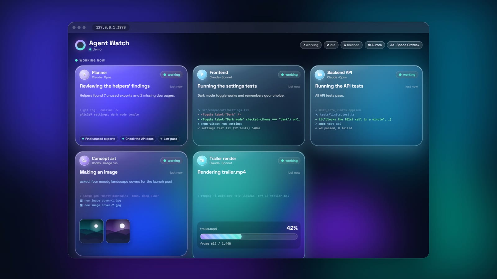
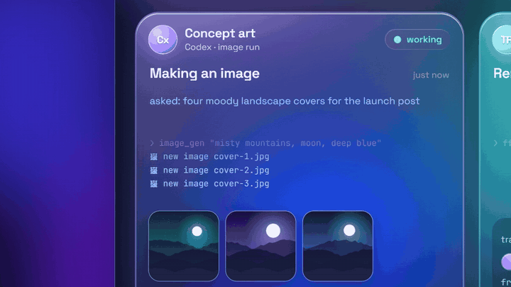

# Agent Watch



**See what every AI agent on your computer is doing, live.** Every Claude Code session, every
helper it sends out and every Codex run gets its own glass bubble: what it's working on in one
plain sentence, its latest words, the commands it's running, images as they're made, and video
renders ticking up to 100%.

[▶ Watch the launch video](https://github.com/Cube3868/agent-watch/releases/latest)



## Try it

You need [Bun](https://bun.sh) 1.1 or newer.

```bash
git clone https://github.com/Cube3868/agent-watch.git
cd agent-watch
bun server.ts
```

Open <http://127.0.0.1:3870>. Leave it open in a browser tab or a side window while your agents work.

No agents running? See it with a made-up crew:

```bash
bun server.ts --demo
```

Options: `--port=4000` (or `AGENT_WATCH_PORT`) to change the port. The **◐** button switches
colors (Aurora, Sunset, Frost, Candy) and **Aa** switches the font; both are remembered.

## What you see

- **Working now**: the agents doing something this minute, each with a big sentence for what
  it's doing, its latest message, and a quiet ticker of its last few commands and edits.
- **Helpers at work**: subagents a session has sent out, smaller, linked to the session that sent them.
- **Waiting**: sessions that have stopped and are waiting for you.
- **Finished recently**: completed helpers and Codex runs, with their images.

Bubbles keep their place. Nothing jumps around as new lines come in.

## What it reads

Everything is read-only. Agent Watch never writes to any of these files.

| What | Where |
|---|---|
| Claude Code sessions | `~/.claude/projects/*/<session>.jsonl` (named by the session's title) |
| Claude Code helpers (subagents) | `~/.claude/projects/*/<session>/subagents/` |
| Live output of background commands | Claude Code's temp folder (`%TEMP%\claude` on Windows; set `CLAUDE_TEMP_DIR` if yours is elsewhere) |
| Codex runs | `~/.codex/sessions/YYYY/MM/DD/rollout-*.jsonl`, names from `~/.codex/session_index.jsonl` |
| Codex images | `~/.codex/generated_images/<run>/` |
| Other images | any image file an agent writes, reads or prints the path of |

Only files touched in the last few hours are followed, and big logs are read from the end, so
it starts instantly and stays light.

## Privacy

- It only listens on `127.0.0.1`: nothing on your network or the internet can reach it.
- Everything shown passes through a redactor first: API keys, tokens, `NAME=secret` pairs,
  private keys and long random-looking strings become `[secret hidden]`.
- Output of commands that print `.env` files, credentials or your environment is not shown at all,
  and file reads show only the file's name.
- Images are served only if an agent touched them; there is no way to ask it for an arbitrary file.

Your logs can still contain private work. Treat the page like your terminal: don't screen-share
it without a look first, or use `--demo`.

## Render progress

A progress bar appears for commands that make a video: ffmpeg encodes, `render.py` /
`make.py render` scripts, Remotion and Blender animation renders. It shows a real percentage
when the render prints one (ffmpeg's own stats, `-progress`, `frame N/M`, or `NN%`), and a
softly glowing bar when it prints nothing.

## Works with

Built and tested on Windows 11 with the Claude Code desktop app and the Codex CLI. The Claude
Code and Codex log layouts are the same on macOS and Linux, so it should work there too; if
something doesn't show up, open an issue with what you expected to see.

## The launch film

The video is made in code from the demo, so you can remake it:

```bash
bun install
bun server.ts --demo --port=3871     # in one terminal
bun run film                          # in another: music bed, then a frame-by-frame recording
```

It writes `launch/out/agent-watch-launch.mp4`. It needs Chrome, ffmpeg, and Python with numpy
(the music is synthesized, so it's free to share).

## How it's built

`server.ts` (a small Bun server with live updates over server-sent events) · `src/claude.ts`
and `src/codex.ts` (log readers) · `src/redact.ts` · `src/progress.ts` · `public/index.html`
(the page, no build step) · `public/demo.js` (the demo crew).

## License

MIT
